# 实践项目2：个人实验报告

## 1. 基本信息

- GitHub 登录名：siyu2026
- 个人仓库地址：https://github.com/siyu2026/my-docs
- 最终网站地址：https://siyu2026.github.io/my-docs/

## 2. 实践过程与关键截图

### 2.1 仓库创建

说明：在GitHub网页端新建公开仓库`my-docs`，勾选初始化README，复制仓库HTTPS地址，在本地终端使用git clone命令克隆仓库到本地，在仓库内配置当前仓库的git用户名与邮箱，完成本地仓库与远程仓库绑定。

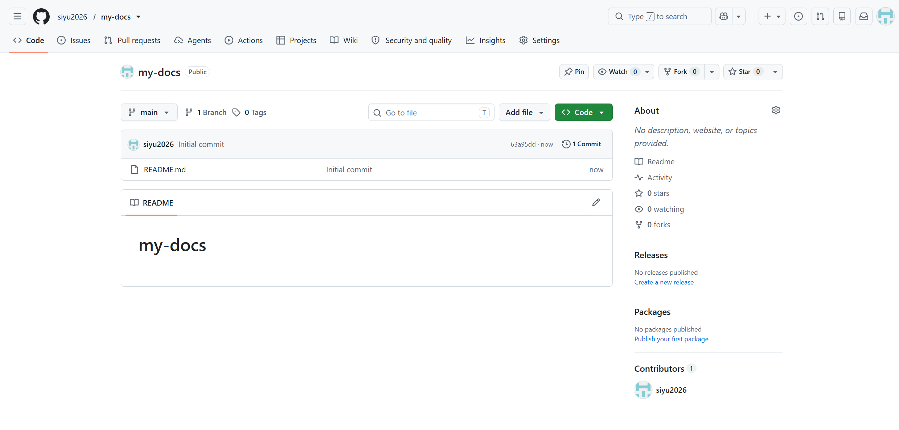

### 2.2 项目结构与 MkDocs 配置

说明：

- `docs/`：存放编写的 Markdown 源文档
- `nav`：mkdocs 配置导航栏，对应 docs 下各个 md 文件
- `site/`：mkdocs 构建生成的静态网站产物，不需要手动编辑、不要提交到 git。

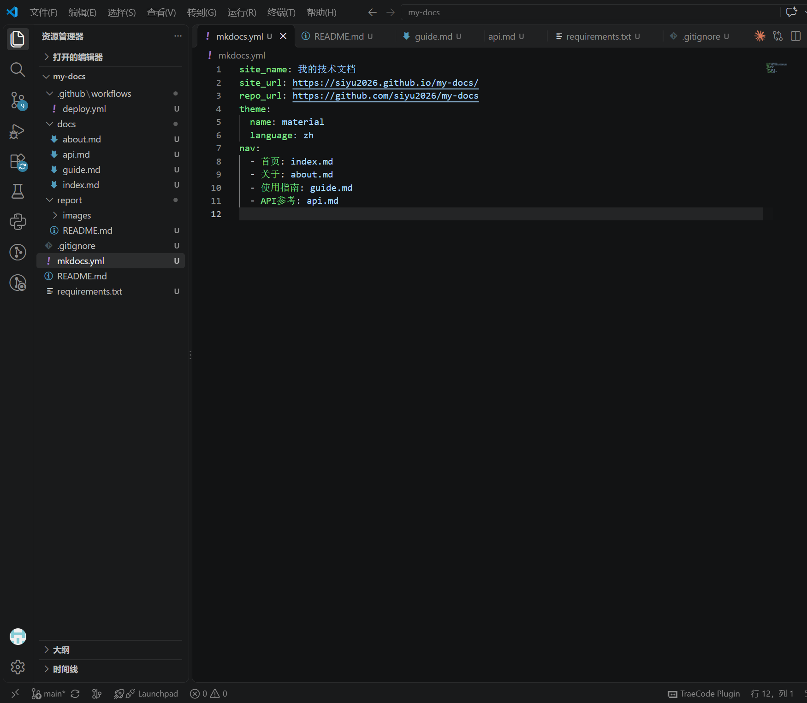

### 2.3 本地构建或预览

说明：创建Python虚拟环境并激活，安装requirements.txt中mkdocs相关依赖，执行`mkdocs build`构建站点，再执行`mkdocs serve`启动本地预览服务，访问127.0.0.1:8000，依次检查4个页面，确认导航跳转、表格、代码块都正常展示。同时，在about.md中记录实践体会。

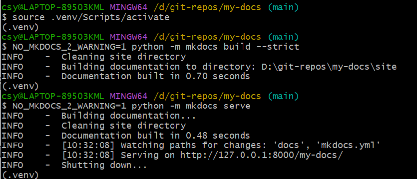

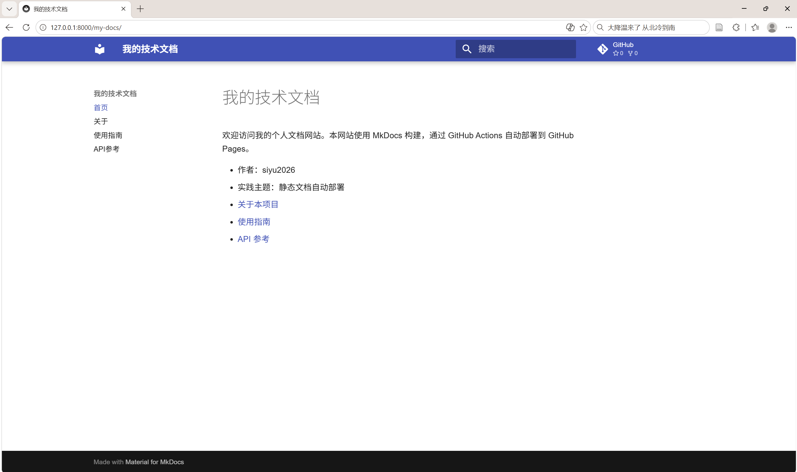

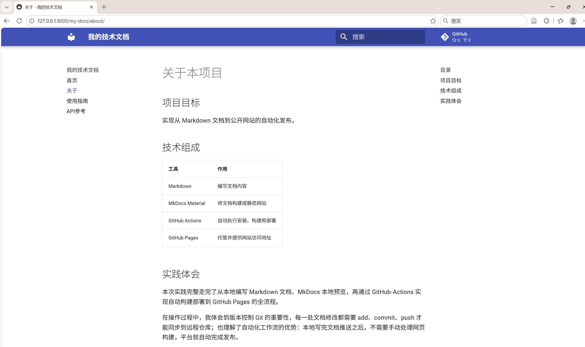

### 2.4 Pages 设置

说明：进入仓库Settings-Pages页面，将Build and deployment的来源设置为GitHub Actions，保存配置，允许工作流运行，为自动部署GitHub Pages做好准备。

1. **触发规则 `on`**

- `push: branches:[main]`：仅向main分支推送代码时触发流水线；
- `paths`路径过滤：仅当修改`docs/**`、`mkdocs.yml`、`requirements.txt`、`deploy.yml`这些文档与部署相关文件才执行部署；修改report等无关目录不会触发工作流；
- `workflow_dispatch`：支持在GitHub网页手动点击运行该工作流。

2. **顶层`permissions: contents: read`**
   build任务只需要读取仓库源码，设置仓库只读权限；写权限单独交给deploy任务，遵循最小权限原则。

3. **`concurrency`并发控制**
   `group: pages`把所有部署归入同一分组；`cancel‑in‑progress: false`，新推送不会强行中断正在运行的部署，保证部署任务完整执行。

4. **jobs 任务分为 build、deploy**

- `build`任务（运行环境`ubuntu‑latest`）：
  - `checkout`：拉取仓库源代码；
  - `setup‑python`：配置Python3.12运行环境；
  - `configure‑pages`：配置Pages部署环境；
  - 安装依赖，执行`mkdocs build --strict`构建静态网站；
  - `upload‑pages‑artifact`：将`site`构建产物上传为流水线工件，供部署阶段使用。
- `deploy`任务，配置`needs: build`：**必须等待build任务成功完成才会执行**；
  - 单独授予`pages: write`、`id‑token: write`部署写入权限；
  - 绑定`github‑pages`环境，调用`deploy‑pages`将工件发布到GitHub Pages服务。

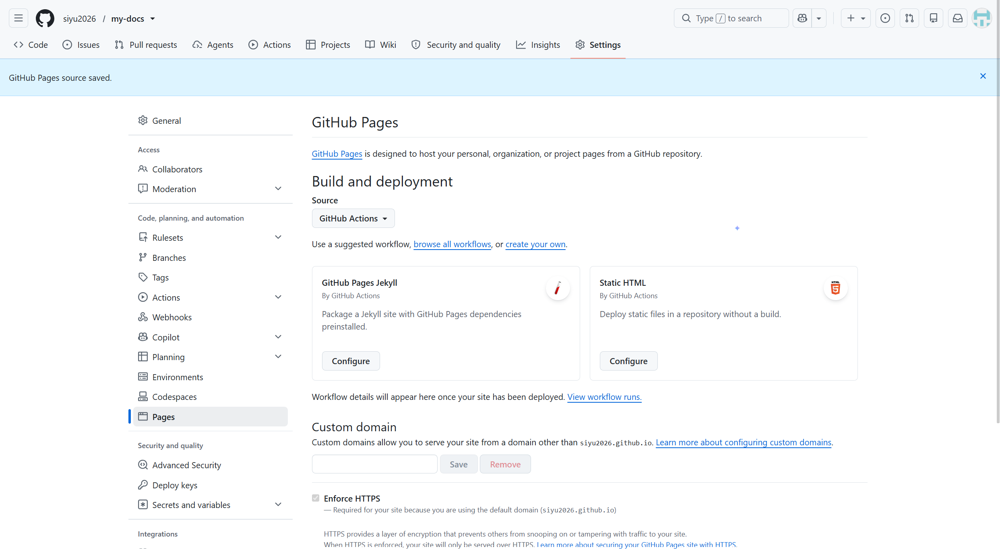

### 2.5 Actions 首次构建和部署

说明：将本地编写好的代码提交并推送到main分支，自动触发deploy.yml工作流；在Actions页面查看任务，build任务构建生成静态文件，deploy任务部署页面，两个Job全部绿色成功，代表部署流程执行完成。

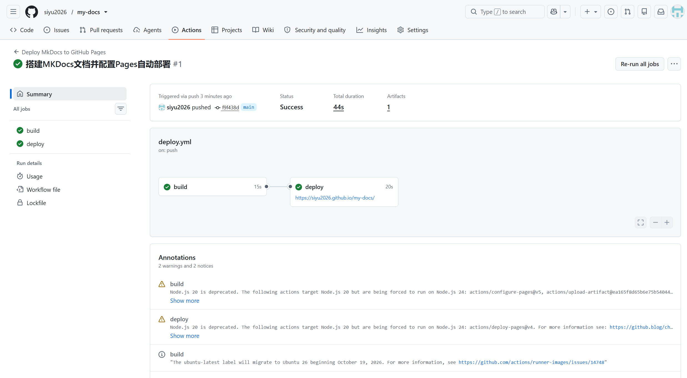

### 2.6 网站访问与四页导航检查

说明：访问GitHub Pages公网地址，依次打开首页、关于、使用指南、API参考四个页面，测试导航菜单跳转，检查表格格式、JSON代码块渲染、页面内超链接，全部展示正常。

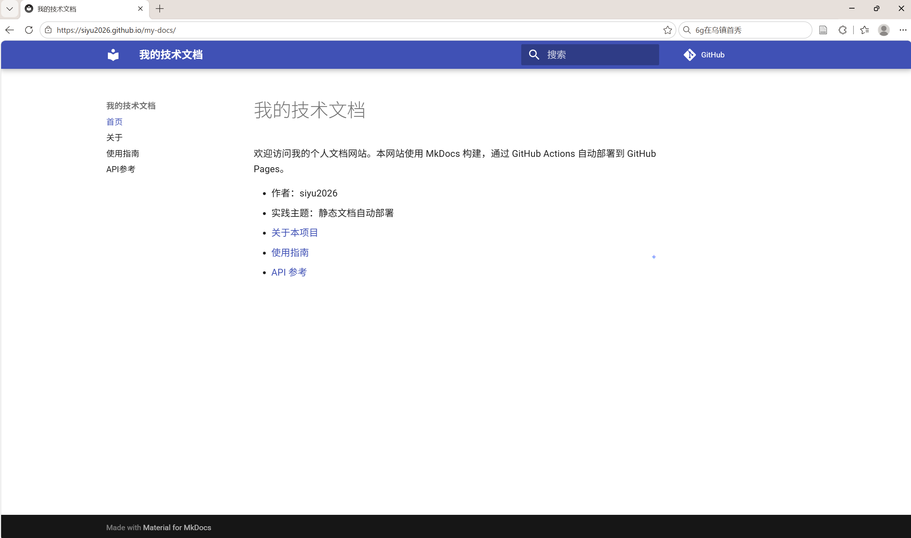

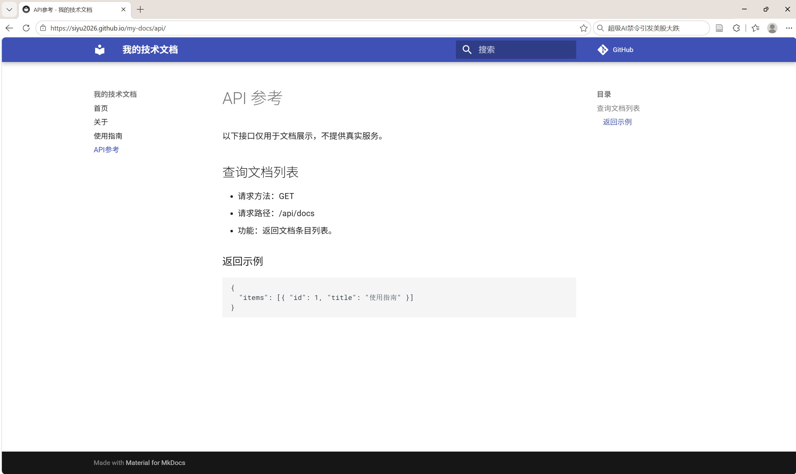

### 2.7 第二次推送与自动更新验证

- 对应提交链接：https://github.com/siyu2026/my-docs/commit/752ccb5b1e6fa329d0e4060b6cc0234bd27569f1
- 对应 Actions 运行链接：https://github.com/siyu2026/my-docs/actions/runs/42045525804

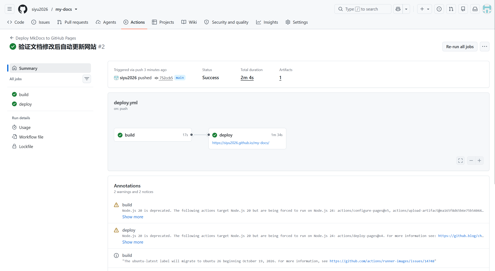

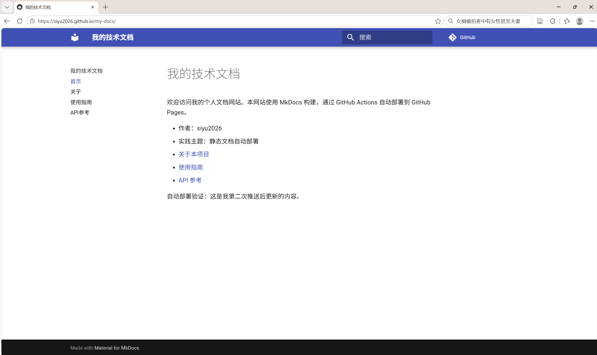

## 3. 问题与解决

**问题描述**：修改 `docs/index.md`，在已有 Markdown 列表末尾追加验证文本时，未添加空行，导致页面渲染后新增文字和上一行链接合并在同一行，排版错乱。

**原因分析**：Markdown 语法对换行有严格要求，列表项结束后，如果不增加空换行，后续文本会被识别为该行的延续内容，和链接渲染在同一行。

**解决方法**：在 Markdown 列表末尾增加一个空白行，再单独写入验证文字，保证文本独立成段；修改文件后，通过 `git add`、`git commit`、`git push` 推送代码，触发 GitHub Actions 流水线重新构建并部署到 GitHub Pages，刷新页面后排版恢复正常。

**总结**：编写 Markdown 文档时需要注意段落之间使用空行分隔，避免渲染时内容粘连；修改源码推送后，自动部署流水线会重新发布静态站点，验证自动更新能力。

## 4. 原理理解

1. docs/ 和 site/ 各保存什么？为什么不用手工修改 site/？

   答： docs/ 存放我们手写的Markdown源文档，是文档的原始内容；site/ 是mkdocs构建命令自动生成的静态HTML、CSS等网页文件。每次执行mkdocs build都会覆盖site目录里的内容，手动修改site下的文件会在下次构建时丢失，因此不需要手工修改。

2. 本次工作流在什么情况下自动运行？

   答： 向main分支推送代码，并且修改的文件匹配工作流里配置的路径（docs目录、mkdocs.yml、requirements.txt、deploy.yml等）时自动触发；同时工作流支持网页手动触发。单纯修改report下的文件不会触发部署。

3. build 与 deploy 两个任务有什么区别？

   答： build任务负责拉取源码、搭建Python环境、安装依赖、执行mkdocs build生成静态站点文件，并且把构建产物上传为工件；deploy任务依赖build成功才会执行，它下载工件，将静态文件部署到GitHub Pages服务上，对外提供网页访问。

4. 只修改 report/README.md 会触发部署吗？为什么？

   答： 不会触发部署。deploy.yml中push触发器配置了paths过滤规则，只有修改文档和部署相关配置文件才会触发工作流，report目录不在触发路径列表内。

5. 本次方案为何无需创建 gh-pages 分支？

   答： 本次使用GitHub官方的Pages工件部署方式，build阶段把静态网站打包成工件上传，deploy阶段直接读取工件部署到Pages服务，由平台内部托管页面，不再需要维护独立的gh-pages分支存放静态网页。
